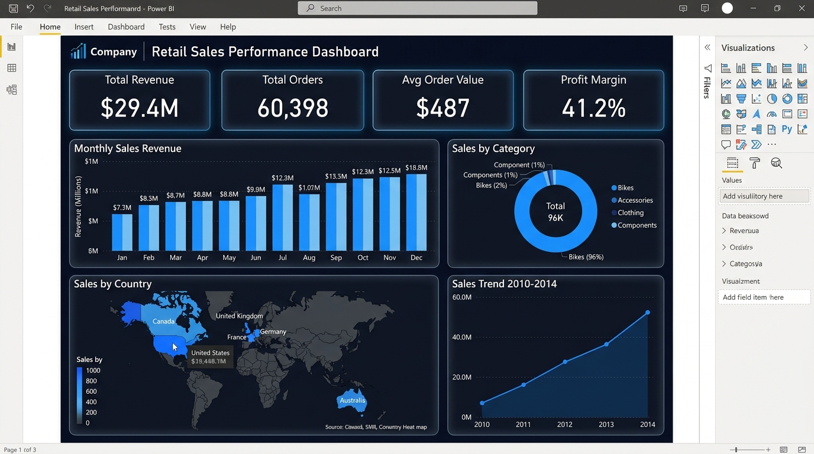

# 📊 Retail Sales Intelligence — End-to-End Data Analysis

<div align="center">


**A complete data analysis pipeline — from raw Excel to interactive dashboard.**

[🚀 Live Dashboard](#-live-dashboard) · [📁 Project Structure](#-project-structure) · [🔧 Setup](#-setup) · [📈 Key Findings](#-key-findings)

</div>

---

## 🎯 Project Overview

This project walks through a full data analysis lifecycle on the **AdventureWorks Internet Sales** dataset (2010–2014) — a realistic retail dataset covering bicycle sales across multiple countries, products, and customer segments.

### What this project demonstrates

| Skill | Tool |
|---|---|
| Data ingestion & schema design | Python · SQLAlchemy · MySQL |
| Data cleaning & transformation | Pandas · SQL |
| Exploratory data analysis (EDA) | Pandas · Matplotlib · Seaborn |
| Interactive visualisation | Plotly · Streamlit |
| Business intelligence dashboard | Power BI · Streamlit Cloud |
| End-to-end pipeline automation | Python scripts |

---

## 🚀 Live Dashboard

> **Deployed on Streamlit Cloud — no installation required.**

[

*Replace the link above with your Streamlit Cloud URL after deployment.*

---

## 🗂️ Dataset

| Property | Value |
|---|---|
| Source | AdventureWorks (Microsoft) |
| Period | December 2010 – January 2014 |
| Rows | ~60,000 transactions |
| Tables | 7 (facts + 6 dimensions) |
| Key columns | SalesAmount, ProductCategory, Geography, Customer demographics |

**Schema (Star Schema)**

```
fact_InternetSales
    ├── dim_Customer          (demographics, income, commute)
    ├── dim_Product           (name, cost, colour)
    │     ├── dim_ProductSubcategory
    │     └── dim_ProductCategory
    ├── dim_SalesTerritory    (country, region)
    └── dim_Currency
```

---

## 📁 Project Structure

```
retail-sales-analysis/
│
├── Data/
│   ├── salesdata.xlsx            # Raw source data (7 sheets)
│   └── df.csv                    # Cleaned, analysis-ready export
│
├── Scripts/
│   ├── End-to-End.ipynb          # Full EDA notebook (20+ analyses)
│   └── export_to_sql.py          # Loads Excel sheets → MySQL tables
│
├── SQL/
│   ├── queries.sql               # All SQL queries (setup → analysis)
│   └── clean_sales_data_table.sql # Cleaned table SQL dump
│
├── PowerBI/
│   └── sales-retail-dashboard.pbix  # Power BI dashboard file
│
├── app.py                        # Streamlit interactive dashboard
├── requirements.txt
├── .env.example                  # Environment variable template
└── README.md
```

---

## 🔧 Setup

### 1 — Clone the repository

```bash
git clone https://github.com/ahmedrizkgawish/retail-sales-analysis.git
cd retail-sales-analysis
```

### 2 — Install dependencies

```bash
pip install -r requirements.txt
```

### 3 — Configure environment

```bash
cp .env.example .env
# Edit .env and fill in your MySQL credentials
```

### 4 — Seed the database

```bash
# Start MySQL, then create the database:
mysql -u root -p -e "CREATE DATABASE sales_database;"

# Load the Excel sheets into MySQL tables:
python Scripts/export_to_sql.py
```

### 5 — Run the Streamlit dashboard locally

```bash
streamlit run app.py
```

### 6 — Open the Jupyter Notebook

```bash
jupyter notebook Scripts/End-to-End.ipynb
```

---

## 📈 Key Findings

### Revenue Performance
- **Total revenue (2010–2013):** $29.4 M across 60 K+ transactions
- **Bikes dominate** — contributing ~96% of total revenue, with Road Bikes and Mountain Bikes as the top two subcategories
- **Strongest quarter:** Q4 across all years, driven by holiday purchasing

### Customer Insights
- **Age 25–60** accounts for ~91% of total revenue — the primary target segment
- **Gender split is nearly equal** (~$14.8M female vs ~$14.5M male), indicating broad appeal
- Customers with a **2–5 mile commute distance** have the highest average transaction value

### Geographic Trends
- **United States** is the top market, followed by Australia and Canada
- Pacific and North America regions show the strongest YoY growth trajectory

### Product Analytics
- **Mountain Bikes** grew **37,249%** in revenue from 2010 to 2013 — the fastest-growing subcategory
- **Accessories** have the highest profit margins despite lower absolute revenue
- Products with no colour data ("Unknown") cluster in the Accessories category

---

## 📊 Power BI Dashboard



The `.pbix` file in `/PowerBI` contains a fully interactive dashboard connected to the cleaned dataset, featuring:

- **Month-wise Sales Bar Chart** — seasonal patterns at a glance
- **Product Category Pie Chart** — Bikes / Clothing / Accessories / Components breakdown
- **Sales Trend Lines** — YoY growth with dynamic time filters
- **Customer Demographics Panel** — gender, income bracket, commute distance cross-filters

> **Don't have Power BI Desktop?** Use the [live Streamlit dashboard](https://YOUR-APP-URL.streamlit.app) for identical insights in your browser.

---

## 🛠️ Tech Stack

| Layer | Technology |
|---|---|
| Data Storage | MySQL 8.0 (star schema) |
| Data Processing | Python 3.11 · Pandas · NumPy |
| SQL Analysis | MySQL Workbench |
| Visualisation | Matplotlib · Seaborn · Plotly |
| Dashboard | Streamlit · Power BI |
| Notebook | Jupyter Lab |

---

## 🔮 Future Enhancements

- [ ] **Forecasting** — ARIMA / Prophet model for 2014 revenue predictions
- [ ] **Customer segmentation** — K-Means clustering on demographics + purchase behaviour
- [ ] **Real-time ingestion** — Kafka or Airflow pipeline replacing the manual Excel load
- [ ] **Unit tests** — pytest suite for the cleaning scripts

---

## 👤 Author

**Ahmed Rizk Gawish**

[](https://www.linkedin.com/in/ahmedrizkgawish/)
[](https://github.com/Ahmed-Rizk1))
---

## 📄 License

This project is licensed under the **MIT License** — feel free to use it as a portfolio reference.

The underlying dataset (AdventureWorks) is provided by Microsoft under their sample data license.
